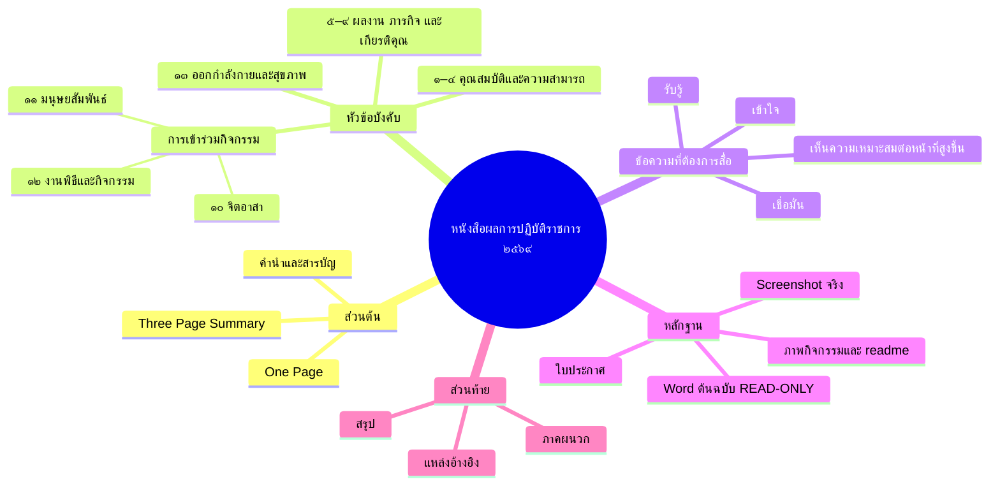
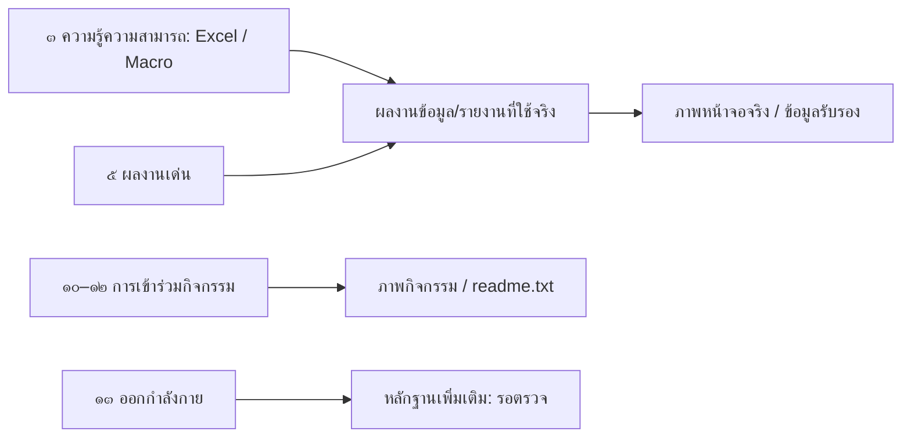

# Mind Map Architecture — หนังสือประเมิน วาระ ๒๕๖๙
สถานะ: PROPOSED | ใช้เป็นเครื่องมือคิดและตรวจความครบ ไม่แทนลำดับบังคับใน Word

## Book Mind Map

## Chapter Map / Content Branch
แต่ละหัวข้อบังคับแตกแขนงเป็น
**Key Message → ข้อเท็จจริง → ผลงาน/บทบาท → ผลสัมฤทธิ์ → หลักฐาน → ภาพประกอบ → สถานะตรวจสอบ**
ให้ผลงานแต่ละรายการมีบทที่อธิบายเต็ม **เพียงหนึ่งบท**; บทอื่นอ้างเลขผลงานแทนการคัดลอกซ้ำ

## Evidence Link Map — ตัวอย่าง

## Editorial validation
1. หัวข้อบังคับทั้ง ๑๓ ข้ออยู่ในผังครบ **แม้จัดกลุ่ม ๑๐–๑๒ ใต้กิจกรรม และแยกข้อ ๑๓**
2. แต่ละผลงานมี owner chapter, evidence ID และ claim status
3. ความเชื่อมโยงระหว่างข้อ ๓ กับผลงานจริงไม่ทำให้ซ้ำเล่า
4. แยกผลงานใช้งานจริง / ต้นแบบ / แนวทางต่อยอด
5. ห้ามอนุมานความสามารถหรือผลจากภาพโดยไม่มีข้อเท็จจริงรองรับ
6. ชุดต้นฉบับ Google Drive READ ONLY; เอกสารใหม่ลง GPT-WORK เท่านั้น

## Workflow
Mind Map → ล็อกสารบัญโดยรักษาหัวข้อบังคับ → ทำแผนเนื้อหาและภาพรายบท → ตรวจหลักฐาน → Word Master Template → ผลิตเล่มใหม่ใน GPT-WORK
